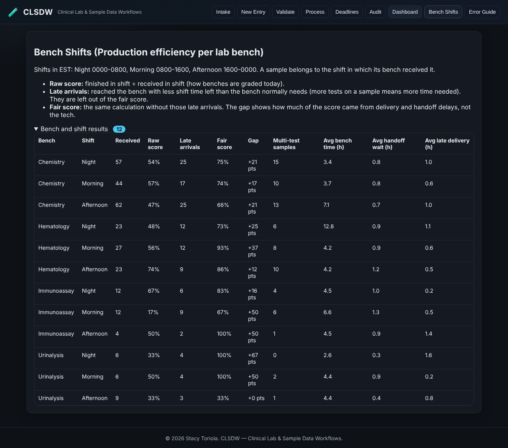
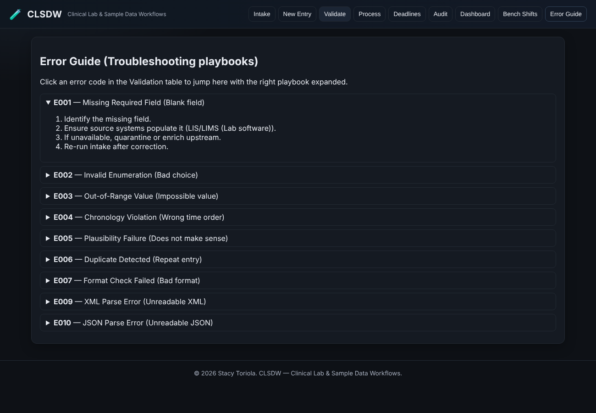

# Clinical Lab Data Workflow
**Author:** Dr. S. L. Toriola, MD, MSc.

**Code Reviewer:** Anthony O.

**Goal:** Learn clinical lab operations analytics by building a monitoring dashboard in JavaScript, Python (FastAPI), and PostgreSQL (Supabase).

## Start Here (plain-language guide)

- **Specimen** = one sample (blood, urine, tissue) sent to the lab for testing.
- **Bench** = a lab department that runs certain tests, such as Hematology or Blood Bank.
- **Shift** = an 8-hour work block: Night 0000-0800, Morning 0800-1600, Afternoon 1600-0000 (EST).
- **TAT (Wait time)** = time from sample arrival to result reported.
- **SLA (Deadline)** = the allowed TAT. STAT (Urgent) = 48 hours, Routine = 7 days.
- **Raw efficiency** = finished in shift divided by received in shift, how benches are graded today.
- **Fair efficiency** = the same score after removing delays outside the tech's control.
- **Quarantine (On hold)** = records that failed validation and are kept out of processing.

## Project

**What it asks**
- Do bench scores show how well the tech worked, or how late the samples arrived?
- How much of a bench's score comes from delivery delays and multi-test handoffs?
- Can a lab see its bottlenecks (slowdowns) from its own records?

**Main goal: fair bench scores (Measuring True Efficiency (Fair) vs Relative Efficiency (Raw))**
- Each bench team gets an 8-hour shift score out of 100%: specimens finished against specimens received.
- That score ignores two things outside the tech's control:
  - **Delivery delays:** specimens arrive late (expected vs actual), leaving too little time to process them.
  - **Multiple tests on one sample:** extra tests add processing time, and the sample often visits another bench first, so the next bench receives it 2 to 3 hours later (for example Hematology: flow cytometry, mass spec for A1c, blood bank ABO and Rh).
- The **Bench Shifts** tab shows both scores side by side for every bench and shift. The gap shows how much of the score came from delivery and handoff, not the tech.
- Times are shown in military hours with EST in parentheses, for example 1430 (2:30 PM EST).

**What it provides**
- A browser dashboard with nine tabs: Intake, New Entry, Validate, Process, Deadlines, Audit, Dashboard, Bench Shifts, and Error Guide.
- Automatic results (Normal, Abnormal) calculated from reference ranges, plus guideline categories.
- A Python (FastAPI) backend that mirrors the dashboard logic, and a PostgreSQL schema that reproduces the dashboard numbers in SQL.
- 136 automated tests for the backend.

**What it tracks**
- **Results:** Normal (In range), Abnormal (Out of range), Inconclusive (Unclear).
- **SLA breach (Missed deadline) rate:** share of reported results whose TAT exceeded the SLA. Editable on the Deadlines tab.
- **TAT (Lab time):** average hours from sample arrival to result reported.
- **Bench production efficiency:** raw and fair scores per bench and shift.
- **Throughput (Daily output):** reported results per day.
- **Specimen (Sample) delivery, expected vs actual:** on-time delivery rate and average hours late by specimen type.
- **Error categories:** every error code (E001 to E010) is defined on the dashboard and in the Error Guide tab.

**Automatic results**
- Normal / Abnormal is calculated from the value, not typed. For each REPORTED sample the app looks up the test in `reference_ranges.js`, picks the range by patient sex and context (for example Fasting or Random glucose), and checks the unit (conventional or SI).
- Outcomes: Normal (In range), Abnormal (Out of range) with a High or Low flag, Borderline (Near limit), Inconclusive (Unclear, kept only when the lab marks it).
- Cannot calculate: No range (Not listed), Unit mismatch (Wrong unit), Sex needed (Missing sex), Context needed (Missing detail).
- Reference ranges: NBME Laboratory Values reference sheet.

**Diagnostic categories (Guideline)**
- A separate column applies national and international guidelines (`diagnostic_criteria.js`). Normal / Abnormal says whether a value is in the lab's range; a guideline category says what it means.
- **Glucose and hemoglobin A1c:** ADA Standards of Care in Diabetes 2026 (below diabetes range, Prediabetes (Higher risk), Diabetes range (Repeat to confirm)).
- **Hemoglobin:** WHO 2024 anemia cutoffs by sex, age (15 and older) and pregnancy. Not adjusted for altitude or smoking.
- **LDL cholesterol:** 2026 ACC/AHA dyslipidemia guideline goals by 10-year heart risk. The risk (PREVENT calculator) is entered, not calculated.

## Foundation

**Structure**
- Root: browser app (`index.html`, `app.js`, `styles.css`), reference tables, sample data, SQL schema.
- `clsdw_backend/`: Python backend, SQL files, and tests.

**Data**
- Synthetic only. `python3 generate_sample_data.py` writes 300 simulated records (`sample_data_large.json` and `sample_data_large.js`). The same seed gives the same data every time.
- On the Intake tab, **Load Large Sample (300)** loads them.
- Reference ranges: NBME Laboratory Values. Guidelines: ADA 2026, WHO 2024, ACC/AHA 2026.

**Data fields (what each record holds)**

| Field | What it means |
|---|---|
| `test` | Name of the lab test, such as Platelet count. Required when `status` is REPORTED |
| `sex` | M or F. Picks the reference range |
| `age` | Patient age in years. Used for hemoglobin cutoffs |
| `ascvdRisk` | 10-year heart risk: LOW, BORDERLINE, INTERMEDIATE or HIGH. Used for the LDL goal |
| `context` | Conditions of the draw, such as FASTING or RANDOM |
| `priority` | STAT (Urgent) or ROUTINE. Sets the SLA |
| `expectedAt` | When the specimen was expected (ISO-8601 time) |
| `receivedAt` | When the specimen actually arrived. Required on every record |
| `reportedAt` | When the result was reported. Required when `status` is REPORTED |
| `bench` | Lab department. Filled in from the test when blank |
| `benchReceivedAt` | When that bench received it. Defaults to `receivedAt` |
| `testCount` | Number of tests on the sample. Defaults to 1 |

**Files and what each does**

| File | What it does |
|---|---|
| `index.html`, `styles.css` | Dashboard page and styling |
| `app.js` | All dashboard logic: validation, processing, SLA, delivery, bench shifts |
| `reference_ranges.js` | NBME ranges and the rule that computes Normal or Abnormal |
| `diagnostic_criteria.js` | ADA, WHO and ACC/AHA guideline categories |
| `generate_sample_data.py` | Writes the 300 simulated records |
| `sample_data_large.json`, `sample_data_large.js` | The simulated records |
| `schema.sql`, `sample_inserts.sql` | PostgreSQL (Supabase) tables, checks, views, and sample rows |
| `clsdw_backend/clsdw_core.py` | Backend business logic, mirrors `app.js` |
| `clsdw_backend/reference_ranges.py`, `.json` | Backend reference ranges and result rule |
| `clsdw_backend/diagnostic_criteria.py` | Backend guideline categories |
| `clsdw_backend/main.py` | FastAPI REST endpoints |
| `clsdw_backend/test_clsdw.py` | 136 pytest tests |
| `clsdw_backend/schema.sql`, `sample_inserts.sql` | Database files for the backend |
| `*.png` | Dashboard screenshots shown below |

**How to run**
- Dashboard: open `index.html` in a browser.
- Backend: see `clsdw_backend/README.md` for setup steps and the endpoint list.

## Dashboard Overview

## Bench Shifts

## Deadlines / SLA Breach Status

## Validation Result

## Error Guide

