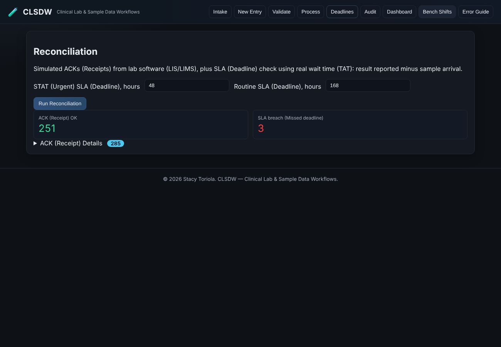
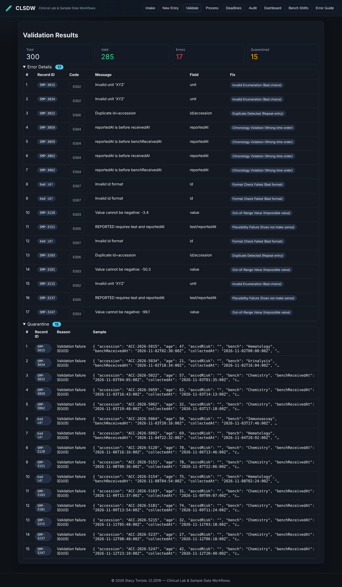

# Clinical Lab Data Workflow

Production-style monitoring dashboard simulating a high-throughput clinical genomics pipeline. 
Implemented SLA/TAT enforcement (STAT 48h, ROUTINE 7 days), batch-level NGS QC rollups, and incident tracking. 
Designed a PostgreSQL (Supabase) relational schema using synthetic data to model sample flow, QC failures, and operational bottlenecks. 

## Dashboard Overview

## Reconciliation / SLA Breach Status

## Validation Result

## Troubleshoot Index

