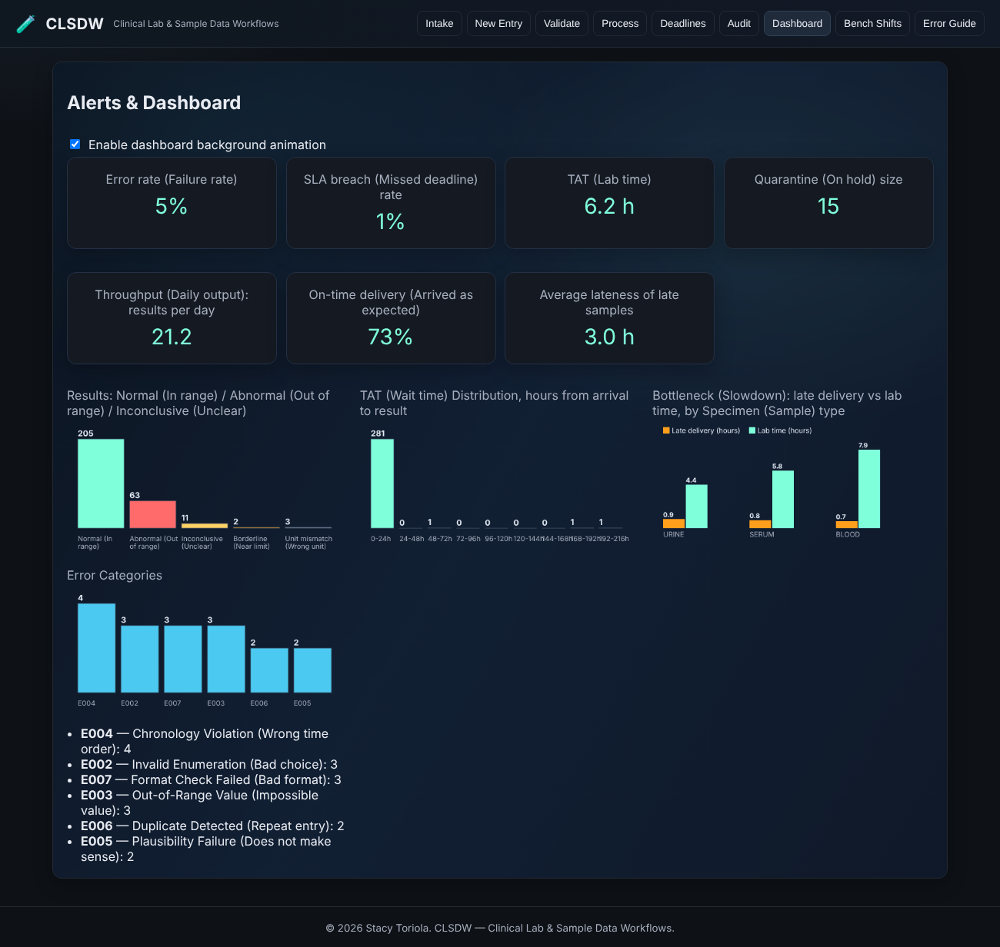

# Clinical Lab Data Workflow

Created By: Dr. Stacy Toriola, MD, MSc.

Production-style monitoring dashboard simulating a high-throughput clinical genomics pipeline (genomics = DNA/RNA testing).
Goal: monitor lab efficiency. Terms are written as Acronym (Short word) so non-lab readers can follow.

## Main goal: fair bench scores
Each lab bench team gets a nightly production efficiency score out of 100%: how many specimens it finished against how many came into its department that night. That score does not account for two things outside the tech's control:
- **Delivery delays:** specimens that arrive late (expected vs actual arrival), leaving too little time to process them.
- **Multiple tests on one sample:** extra tests add processing time, and the sample often visits another bench first, so the next bench receives it 2 to 3 hours later (for example Hematology: flow cytometry, mass spec for A1c, blood bank ABO and Rh).

The **Bench Shifts** tab shows two scores side by side for every bench and shift (Night 0000-0800, Morning 0800-1600, Afternoon 1600-0000 EST):
- **Raw score:** finished in shift / received in shift (how benches are graded today).
- **Fair score:** the same, leaving out samples that reached the bench with less shift time left than the bench normally needs (time needed grows with the number of tests). The gap shows how much of the score came from delivery and handoff, not the tech.

Times are shown in military hours with EST in parentheses, for example 1430 (2:30 PM EST).

## What it tracks
- **Results:** Normal (In range), Abnormal (Out of range), Inconclusive (Unclear).
- **SLA breach (Missed deadline) rate:** share of reported results whose TAT (Wait time) exceeded the SLA (Deadline). TAT (Wait time) = result reported minus sample arrival. STAT (Urgent) = 48 hours, Routine = 7 days (editable on the Deadlines tab).
- **TAT (Lab time):** average hours from sample arrival to result reported.
- **Bench production efficiency:** raw and fair scores per bench and shift (see Main goal).
- **Quarantine (On hold):** records that failed validation and are held out of processing.
- **Throughput (Daily output):** reported results per day.
- **Specimen (Sample) delivery, expected vs actual:** on-time delivery rate and average hours late by specimen type, used for Bottleneck (Slowdown) analysis.
- **Error categories:** every error code is defined on the dashboard and in the Error Guide tab.

Designed around a PostgreSQL (Supabase) relational schema using synthetic data to model sample flow, QC (Quality check) failures, and operational bottlenecks.

## Automatic results
Normal / Abnormal is calculated from the value, not typed. For each REPORTED sample the app looks up the test in `reference_ranges.js`, picks the range by patient sex and context (for example Fasting or Random glucose), and checks the unit (conventional or SI).
- Normal (In range), Abnormal (Out of range) with a High / Low flag, Borderline (Near limit)
- Inconclusive (Unclear): kept only when the lab marks it
- No range (Not listed), Unit mismatch (Wrong unit), Sex needed (Missing sex), Context needed (Missing detail)

The computed result replaces any typed result.

Reference ranges: NBME Laboratory Values reference sheet.

## Diagnostic categories (Guideline)
A separate column applies national and international guidelines (`diagnostic_criteria.js`). Normal / Abnormal says whether a value is in the lab's range; a guideline category says what it means.
- **Glucose and hemoglobin A1c:** ADA Standards of Care in Diabetes 2026 (below diabetes range, Prediabetes (Higher risk), Diabetes range (Repeat to confirm)).
- **Hemoglobin:** WHO 2024 anemia cutoffs by sex, age (15 and older) and pregnancy. Not adjusted for altitude or smoking.
- **LDL cholesterol:** 2026 ACC/AHA dyslipidemia guideline goals by 10-year heart risk. The risk (PREVENT calculator) is entered, not calculated.

## Data fields
`test`, `sex` (M or F), `age`, `ascvdRisk` (LOW, BORDERLINE, INTERMEDIATE or HIGH), `context`, `priority` (STAT or ROUTINE), `expectedAt`, `receivedAt`, `reportedAt` (ISO-8601 timestamps), `bench`, `benchReceivedAt`, `testCount`. `receivedAt` (actual arrival) is required on every record. `test` and `reportedAt` are required when `status` is REPORTED. `bench` is filled in from the test when blank, `benchReceivedAt` defaults to `receivedAt`, and `testCount` defaults to 1.

## Sample data
`python3 generate_sample_data.py` writes 300 simulated records (`sample_data_large.json` and `sample_data_large.js`). The same seed gives the same data every time. On the Intake tab, **Load Large Sample (300)** loads them.

## Dashboard Overview

## Bench Shifts

## Deadlines / SLA Breach Status

## Validation Result

## Error Guide

